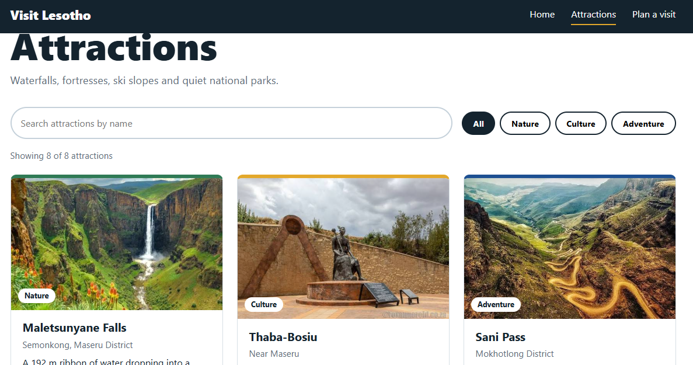
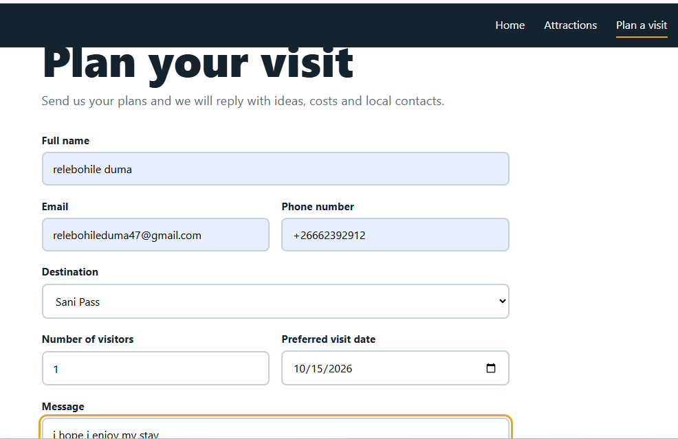
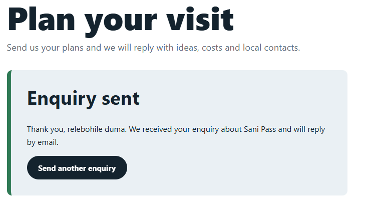

# Visit Lesotho

Interactive tourism web application for Lesotho, built with React and Vite.
Web Design II (DIWP3110), Individual Assignment 2b.

## Features
- Home page with hero, about Lesotho, featured destinations, popular activities
- Attractions page: 8 destinations stored in an array of objects and rendered dynamically
- Search by name and filter by category, with live results
- Attraction details popup using React state and event handling
- Visitor enquiry form with validation, error messages and confirmation
- Responsive layout for desktop, tablet and mobile

## Run locally
```bash
npm install
npm run dev
```
Open the address shown in the terminal (usually http://localhost:5173).

## Folder structure
```
public/images/        photos (see README.txt inside)
src/data/             attractions.js (array of objects)
src/components/       Navbar, Hero, AttractionCard, SearchFilter,
                      AttractionDetails, EnquiryForm, Footer
src/pages/            Home, Attractions, Enquiry
src/App.jsx           routes
src/index.css         styles and responsive rules
screenshots/          project screenshots (desktop, tablet, mobile)
```

## React concepts used
- Components, JSX and props: AttractionCard, SearchFilter, Hero, AttractionDetails
- useState: search, category, selected attraction, form values, errors, menu
- useEffect: Escape key and scroll lock in AttractionDetails
- useMemo: filtered results
- Event handling: onChange, onClick, onSubmit

## Screenshots

### Home page


### Attractions page


### Visitor enquiry form


### Enquiry confirmation message

## Git workflow
```bash
git init
git add .
git commit -m "Initial React project"
git branch -M main
git remote add origin https://github.com/YOUR-USERNAME/visit-lesotho.git
git push -u origin main
```
Commit after each feature (for example: "Add attractions data", "Add search and filter").
